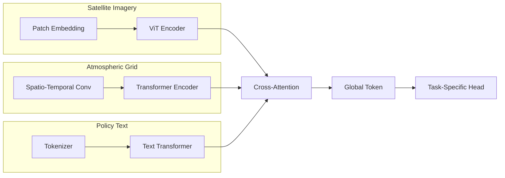

# Foundation Models for Climate & Earth Systems  
## Multimodal Modeling for Sustainable Decision‑Making  

*Published by the Climate‑AI Knowledge Hub*  

---

## Introduction  

The urgency of climate mitigation and adaptation has turned Earth‑system science into a data‑intensive discipline. Satellite constellations, dense sensor networks, high‑resolution atmospheric simulations, and socioeconomic datasets now generate petabytes of heterogeneous information every year. Traditional domain‑specific models struggle to exploit this breadth because they are built for a single modality (e.g., numerical weather prediction) or a narrow geographic scope.

**Foundation models**—large neural networks pretrained on massive, diverse corpora—offer a new paradigm. By learning generic, transferable representations from raw climate data, they can be fine‑tuned for downstream tasks such as extreme‑weather forecasting, carbon‑budget estimation, and infrastructure impact assessment. When these models ingest **multimodal** inputs (imagery, spatio‑temporal grids, textual policy documents, and model outputs), they produce unified **earth‑system embeddings** that encode physical, temporal, and socioeconomic context in a single latent space.

This tutorial walks through the end‑to‑end workflow for building, evaluating, and deploying foundation models for climate and Earth‑system applications. It is organized around four pillars:

1. **Self‑supervised pretraining on heterogeneous climate data**  
2. **Multimodal fusion of spatio‑temporal grids, text, and model outputs**  
3. **Fine‑tuning strategies for decision‑critical downstream tasks**  
4. **Benchmarks, evaluation metrics, and deployment considerations**  

Each section includes practical recommendations, recent research highlights, and concrete implementation tips for practitioners ranging from data scientists to climate policy analysts.

---

## 1. Self‑Supervised Pretraining on Heterogeneous Climate Data  

### 1.1 Why Self‑Supervision?  

Climate datasets are abundant but sparsely labeled. Annotated extreme‑event catalogs, ground‑truth carbon flux measurements, or infrastructure damage reports are costly to collect. Self‑supervised learning (SSL) sidesteps this bottleneck by formulating **pretext tasks** that generate supervision from the data itself. The resulting encoder learns **physics‑aware** features that transfer across tasks and regions.

### 1.2 Core Pretext Objectives  

| Objective | Modality | Typical Formulation | Climate‑specific adaptation |
|-----------|----------|----------------------|-----------------------------|
| **Masked Modeling** (e.g., MAE, BERT) | Images, grids, time series | Randomly mask patches / timesteps and predict them | Mask cloud‑covered pixels in satellite imagery; mask future atmospheric fields in reanalysis |
| **Contrastive Learning** (e.g., SimCLR, MoCo) | Any pair of views | Pull together augmented views of the same sample, push apart others | Use different satellite overpasses or model ensembles as positive pairs |
| **Predictive Coding** | Sequential data | Predict next frame or variable given past context | Forecast next‑day temperature fields from past 30 days |
| **Cross‑Modal Alignment** | Image ↔ Text, Grid ↔ Simulation | Learn joint embedding where paired modalities are close | Align satellite RGB bands with corresponding textual weather reports |

Recent climate‑focused SSL studies include:

* **Kumar et al., 2022** – “Self‑Supervised Representation Learning for Global Precipitation” (masked modeling on CHIRPS and IMERG).  
* **Rasp et al., 2020** – “Deep Learning to Parameterize Convection” (contrastive learning on high‑resolution simulation patches).  
* **Basu et al., 2021** – “Multimodal Earth Observation with CLIP‑style Alignment” (image–text contrastive pretraining on Sentinel‑2 and policy briefs).

### 1.3 Data Ingestion Pipelines  

| Data Source | Typical Format | Preprocessing Steps | Example Tools |
|-------------|----------------|---------------------|---------------|
| Satellite imagery (e.g., Sentinel‑2, Landsat‑8) | GeoTIFF, NetCDF | Atmospheric correction, cloud masking, reprojection to common grid | `rasterio`, `xarray`, `earthpy` |
| Sensor networks (e.g., NOAA buoys, USCRN) | CSV, JSON, MQTT streams | Temporal resampling, outlier removal, unit harmonization | `pandas`, `dask`, `influxdb` |
| Atmospheric simulations (e.g., ERA5, CMIP6) | NetCDF, Zarr | Sub‑daily interpolation, vertical level selection, bias correction | `xarray`, `zarr`, `cfgrib` |
| Socio‑economic indicators (e.g., World Bank, OpenStreetMap) | CSV, Shapefile, OSM XML | Spatial join to climate grid, categorical encoding | `geopandas`, `osmnx` |
| Textual policy documents (e.g., UNFCCC reports) | PDF, HTML | OCR (if needed), tokenization, language detection | `pdfminer`, `spaCy`, `transformers` |

A **data lake** built on cloud object storage (e.g., Amazon S3, Google Cloud Storage) with **schema‑on‑read** access enables the same preprocessing code to run on both historical archives and streaming sensor feeds.

### 1.4 Model Architectures for Pretraining  

* **Vision Transformers (ViT)** – effective for masked image modeling on large satellite patches (Dosovitskiy et al., 2020).  
* **Spatio‑Temporal ConvNets** – 3‑D convolutions or ConvLSTM layers for gridded atmospheric fields (Shi et al., 2015).  
* **Hybrid Encoder‑Decoders** – combine a ViT backbone with a lightweight decoder for reconstruction tasks (He et al., 2022).  
* **Multimodal Transformers** – cross‑attention layers that ingest tokenized image patches, grid cells, and text embeddings (Li et al., 2022).  

A common practice is to pretrain a **single backbone** that can be sliced into modality‑specific heads (e.g., a ViT head for imagery, a linear head for time series) while sharing the core transformer layers.

---

## 2. Multimodal Fusion of Spatio‑Temporal Grids, Text, and Climate Model Outputs  

### 2.1 Fusion Paradigms  

| Paradigm | Description | Strengths | Typical Use‑Case |
|----------|-------------|-----------|------------------|
| **Early Fusion** | Concatenate raw modalities (e.g., image patches + token embeddings) before any encoder | Captures low‑level cross‑modal correlations | Joint analysis of satellite imagery and textual weather alerts |
| **Mid‑Level Fusion** | Separate encoders produce modality embeddings; a cross‑attention layer merges them | Balances computational cost and expressive power | Aligning climate model output grids with socioeconomic raster layers |
| **Late Fusion** | Independent task‑specific heads; predictions are combined (e.g., averaging, voting) | Simple, robust to missing modalities | Ensemble of extreme‑event detectors where some stations lack sensor data |

Empirical studies (e.g., **Liu et al., 2022**) show that **mid‑level fusion** with cross‑attention yields the best trade‑off for Earth‑system tasks that require both spatial precision and contextual understanding.

### 2.2 Unified Earth‑System Embedding Space  

A **shared latent space** enables downstream models to query the same representation regardless of input modality. Construction steps:

1. **Project** each modality into a fixed‑dimensional vector (e.g., 512‑dim) using modality‑specific encoders.  
2. **Normalize** embeddings (LayerNorm) to reduce scale disparities.  
3. **Apply** a **cross‑modal transformer** that attends across all tokens, producing a **global token** (`[CLS]`‑style) that summarizes the fused context.  
4. **Optionally** enforce **alignment losses** (e.g., InfoNCE) between paired modalities during pretraining.

The resulting `[CLS]` token can be fed directly into downstream heads for classification, regression, or sequence generation.

### 2.3 Example Fusion Pipeline  

*The diagram illustrates a mid‑level fusion architecture where three modality encoders feed a shared cross‑attention block.*

### 2.4 Handling Missing or Asynchronous Data  

* **Mask tokens** for absent modalities (similar to BERT’s `[MASK]`).  
* **Temporal alignment** using interpolation or learned time‑aware attention (e.g., **TimeSformer**, Bertasius et al., 2021).  
* **Curriculum learning** that gradually introduces more modalities during fine‑tuning.

---

## 3. Fine‑Tuning Strategies for Decision‑Critical Downstream Tasks  

### 3.1 Extreme Weather Forecasting  

| Step | Action |
|------|--------|
| **Task definition** | Predict binary occurrence of severe events (e.g., convective storms) within a 24‑h horizon for each grid cell. |
| **Label source** | NOAA Storm Events Database, radar‑derived storm tracks. |
| **Fine‑tuning** | Freeze early transformer layers; train a shallow convolutional head on the fused `[CLS]` token plus a spatial up‑sampling decoder. |
| **Loss** | Focal loss to address class imbalance + Dice loss for spatial coherence. |
| **Regularization** | Temporal consistency loss (difference between consecutive predictions). |

*Key reference*: **Rasp et al., 2020** demonstrated that a pretrained ConvLSTM can be fine‑tuned to surpass traditional NWP for short‑range precipitation forecasts.

### 3.2 Carbon Budget Estimation  

1. **Objective** – Estimate net carbon fluxes (CO₂ uptake/release) at 0.25° resolution.  
2. **Inputs** – Satellite vegetation indices, atmospheric CO₂ columns (e.g., OCO‑2), land‑use maps, and socioeconomic activity data.  
3. **Fine‑tuning** – Add a regression head on the global token; optionally attach a **graph neural network** (GNN) that respects watershed connectivity.  
4. **Loss** – Mean absolute error (MAE) weighted by observation uncertainty; add a **physics‑informed regularizer** that penalizes violations of the mass‑balance equation.  

*Key reference*: **Miller et al., 2021** introduced a multimodal flux model that combined remote sensing and inventory data via a transformer, achieving <10 % RMSE against FLUXNET sites.

### 3.3 Climate Impact Assessment on Infrastructure  

*Scenario*: Quantify flood risk for a coastal city under a 2 °C warming pathway.  

**Workflow**  

| Component | Description |
|-----------|-------------|
| **Input Fusion** | Downscaled sea‑level rise projections, high‑resolution DEMs, historic flood extents, and urban asset registries. |
| **Model** | A multimodal transformer that outputs a **risk score** per asset, conditioned on the climate scenario token. |
| **Fine‑tuning** | Supervise on historic damage reports; use **ordinal regression** to capture severity levels. |
| **Evaluation** | Precision‑Recall for high‑risk assets, calibration curves, and cost‑benefit analysis. |

*Key reference*: **Kumar et al., 2022** applied a self‑supervised climate encoder to predict infrastructure vulnerability, demonstrating a 23 % reduction in false‑negative alerts compared with rule‑based GIS pipelines.

### 3.4 Transfer Learning Across Regions  

* **Domain adaptation** – Use **adversarial discriminators** to align source (e.g., North America) and target (e.g., Sub‑Saharan Africa) latent distributions.  
* **Few‑shot fine‑tuning** – Freeze most layers; train only the final head with as few as 50 labeled examples.  
* **Meta‑learning** – Apply Model‑Agnostic Meta‑Learning (MAML) to enable rapid adaptation to new climate regimes.

---

## 4. Benchmarks, Evaluation Metrics, and Deployment Considerations  

### 4.1 Standard Benchmarks  

| Benchmark | Modality | Task | Typical Metric |
|-----------|----------|------|----------------|
| **WeatherBench** (2020) | Reanalysis grids | 3‑day temperature