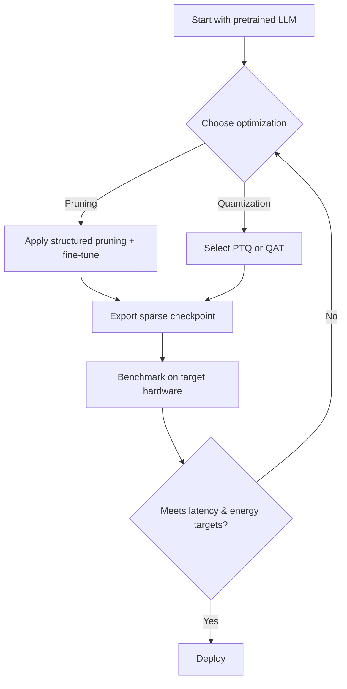

# Energy‑Efficient, Green AI, and Sustainable Deployment of Large Language Models  

Large language models (LLMs) have unlocked unprecedented capabilities in natural language processing, but their training and inference costs raise serious environmental and societal concerns. This tutorial walks through the most impactful strategies for **reducing energy consumption**, **tracking carbon impact**, and **deploying LLMs responsibly**. We cover:

* Model pruning and quantization for inference efficiency  
* Hardware‑aware neural architecture search (HW‑NAS) tailored to LLMs  
* Carbon‑footprint measurement and reporting standards  
* Federated and on‑device inference for privacy‑preserving, sustainable AI  

By the end of this guide you will understand how these techniques interlock to form a **green AI** workflow that can be applied to both research prototypes and production systems.

---

## 1. Introduction  

The rapid scaling of LLMs—often exceeding hundreds of billions of parameters—has outpaced the energy efficiency of the underlying compute infrastructure. Training a single state‑of‑the‑art model can emit **hundreds of metric tons of CO₂**, comparable to the lifetime emissions of a passenger vehicle (Strubell *et al.*, 2020). Moreover, inference at scale (e.g., serving millions of queries per day) can dominate operational energy use.

**Green AI** advocates for transparent reporting of energy and carbon metrics, and for designing models that achieve comparable performance with lower resource demands. Sustainable deployment therefore requires a **holistic approach** that spans model design, hardware selection, runtime optimization, and monitoring.

---

## 2. Model Pruning and Quantization for Inference Efficiency  

### 2.1 Why Pruning and Quantization Matter  

- **Pruning** removes redundant weights or entire neurons, reducing the number of arithmetic operations.  
- **Quantization** lowers the numeric precision of weights and activations (e.g., from 32‑bit floating point to 8‑bit integer), shrinking memory bandwidth and enabling faster matrix multiplications on specialized accelerators.

Both techniques can cut **inference latency** by 2–4× and **energy consumption** by a similar factor, with minimal loss in downstream task performance when applied carefully.

### 2.2 Pruning Strategies  

| Strategy | Description | Typical Compression Ratio |
|----------|-------------|---------------------------|
| **Unstructured magnitude pruning** (Han *et al.*, 2015) | Zeroes out individual weights below a global threshold. | 5–10× |
| **Structured channel/row pruning** | Removes entire channels, rows, or attention heads, preserving hardware-friendly sparsity. | 2–4× |
| **Dynamic sparsity (RigL)** | Updates sparse connectivity during training, maintaining high accuracy at high sparsity levels. | 10–20× (with careful tuning) |

**Best practice:** Combine a short fine‑tuning phase after pruning to recover any accuracy loss, and verify that the target hardware supports the resulting sparsity pattern (e.g., NVIDIA Ampere’s 2:4 structured sparsity).

### 2.3 Quantization Techniques  

| Technique | Precision | Typical Use‑Case |
|-----------|-----------|------------------|
| **Post‑Training Quantization (PTQ)** (Jacob *et al.*, 2018) | 8‑bit integer (INT8) | Fast deployment, minimal retraining |
| **Quantization‑Aware Training (QAT)** | 8‑bit (or mixed 4‑bit) | Higher accuracy for aggressive quantization |
| **Weight‑only quantization (e.g., GPT‑Q, 4‑bit)** | 4‑bit integer | Large LLMs where memory is the bottleneck |

When quantizing LLMs, **mixed‑precision** approaches—keeping key layers (e.g., layer‑norm, softmax) in higher precision—often preserve perplexity while still delivering large energy savings.

### 2.4 Practical Workflow  

*The diagram illustrates an iterative loop that converges on a model meeting both performance and sustainability goals.*

---

## 3. Hardware‑Aware Neural Architecture Search for LLMs  

### 3.1 Motivation  

Even with pruning and quantization, the **macro‑architecture** (depth, width, attention pattern) heavily influences energy consumption. Manually designing LLMs for a specific accelerator is time‑consuming and error‑prone. **Hardware‑aware NAS (HW‑NAS)** automates this process by incorporating latency, power, and memory constraints directly into the search objective.

### 3.2 Key HW‑NAS Methods  

| Method | Core Idea | Representative Works |
|--------|-----------|-----------------------|
| **Differentiable NAS with latency predictor** | Jointly optimizes architecture parameters and a surrogate model of hardware latency. | FBNet (Wu *et al.*, 2019) |
| **One‑Shot NAS (Once‑for‑All)** | Trains a supernet once; sub‑networks are sampled and evaluated without retraining. | OFA (Cai *et al.*, 2020) |
| **Multi‑objective evolutionary search** | Evolves architectures toward Pareto‑optimal trade‑offs among FLOPs, memory, and latency. | MnasNet (Tan *et al.*, 2019) |

### 3.3 Applying HW‑NAS to LLMs  

1. **Define a search space** that captures LLM‑specific dimensions: number of transformer layers, hidden size, number of attention heads, and optional sparsity patterns.  
2. **Collect hardware metrics** (e.g., latency, power) for a representative set of candidate configurations on the target device (GPU, TPU, edge ASIC).  
3. **Train a performance predictor** (e.g., Gaussian Process or lightweight neural net) to estimate both task accuracy (e.g., language modeling loss) and energy cost.  
4. **Run the search** with a multi‑objective formulation:  

   \[
   \min_{\alpha} \; \bigl( \underbrace{\text{Loss}(\alpha)}_{\text{Task accuracy}}, \; \underbrace{\text{Energy}(\alpha)}_{\text{Power × Time}} \bigr)
   \]

5. **Select the Pareto‑optimal architecture** that meets the desired accuracy‑efficiency trade‑off and fine‑tune it using the same pruning/quantization pipeline described earlier.

### 3.4 Benefits  

- **Tailored efficiency**: Architectures can exploit specific hardware features (e.g., tensor cores, systolic arrays).  
- **Reduced carbon cost**: Fewer training epochs are needed because the search operates on a supernet rather than training each candidate from scratch.  
- **Scalability**: The same methodology can be reused for different model sizes or downstream tasks.

---

## 4. Carbon‑Footprint Measurement and Reporting Standards  

Transparent reporting is essential for **accountability** and for driving community‑wide improvements. Several standards and tools have emerged:

| Standard / Tool | Scope | Notable Publication |
|-----------------|-------|----------------------|
| **Carbontracker** (Lacoste *et al.*, 2020) | Estimates CO₂ emissions during training by monitoring power draw and location‑specific carbon intensity. | *Proceedings of the 2020 ACM SIGKDD* |
| **MLCO₂** (Bender *et al.*, 2021) | Provides a unified API for logging energy, carbon, and hardware usage across frameworks. | *arXiv:2102.05671* |
| **ISO 14064‑1** (International Organization for Standardization, 2018) | General methodology for greenhouse‑gas accounting and verification. | ISO standard |
| **Green AI reporting checklist** (Strubell *et al.*, 2020) | Recommends disclosing FLOPs, hardware, training time, and carbon emissions. | *Communications of the ACM* |

### 4.1 Measuring Energy Consumption  

1. **Instrument the training loop** with power‑monitoring APIs (e.g., NVIDIA‑NVML, Intel RAPL).  
2. **Record the carbon intensity** (kg CO₂/kWh) of the data‑center location using publicly available grid data (e.g., electricityMap).  
3. **Compute total emissions**:  

   \[
   \text{CO₂}_{\text{total}} = \sum_{t=1}^{T} P_t \times \Delta t \times \text{CI}_t
   \]

   where \(P_t\) is instantaneous power, \(\Delta t\) the measurement interval, and \(\text{CI}_t\) the carbon intensity at time \(t\).

### 4.2 Reporting Guidelines  

- **Hardware description** (GPU/TPU model, number of chips).  
- **Training configuration** (batch size, epochs, optimizer).  
- **Energy metrics** (total kWh, average power).  
- **Carbon metrics** (kg CO₂, location‑adjusted).  
- **Mitigation actions** (use of renewable energy, model compression).  

Including these details in a dedicated “Sustainability” section of a paper or technical report aligns with the **Green AI** ethos and enables reproducible comparisons.

---

## 5. Federated and On‑Device Inference for Privacy and Sustainability  

### 5.1 The Sustainability Angle  

Running inference on edge devices (smartphones, IoT hubs) reduces data‑center traffic, cuts network energy, and improves latency. When combined with **federated learning**—where model updates are computed locally and aggregated centrally—organizations can:

- **Avoid transmitting raw user data**, preserving privacy.  
- **Leverage idle compute on billions of devices**, distributing the energy load.  

### 5.2 Federated Inference Workflow  

1. **Deploy a compact LLM** (e.g., a quantized 2‑B parameter model) to devices.  
2. **Perform inference locally** for user‑specific queries.  
3. **Optionally aggregate usage statistics** (e.g., token counts) in a privacy‑preserving manner (secure aggregation).  
4. **Periodically update the model** via federated averaging (FedAvg) (McMahan *et al.*, 2017) using on‑device gradients derived from anonymized user interactions.

### 5.3 On‑Device Optimization Techniques  

- **Model distillation**: Train a small “student” model to mimic the large LLM’s outputs, dramatically reducing compute (Hinton *et al.*, 2015).  
- **Operator fusion**: Combine multiple transformer operations into a single kernel to minimize memory traffic on mobile GPUs.  
- **Dynamic runtime scaling**: Adjust precision or layer depth based on battery level or thermal constraints.

### 5.4 Real‑World Examples  

- **Apple’s on‑device language model** for predictive typing, which runs entirely on the iPhone’s Neural Engine using 8‑bit quantization.  
- **Google’s Gboard** leverages federated learning to improve next‑word prediction without sending keystrokes to the cloud.

These deployments demonstrate that **privacy‑preserving inference can be energy‑efficient**, especially when the alternative would involve transmitting data to a remote server for processing.

---

## 6. Integrating the Pieces: A Green AI Deployment Pipeline  

1. **Start with a high‑performing pretrained LLM.**  
2. **Apply HW‑NAS** to discover an architecture that respects target hardware constraints.  
3. **Compress the architecture** using structured pruning followed by quantization‑aware training.  
4. **Benchmark energy and latency** on the intended platform; iterate if targets are not met.  
5. **Measure carbon emissions** throughout training and fine‑tuning with Carbontracker or MLCO₂, and document them per the Green AI checklist.  
6. **Deploy** either as a cloud service (with efficient inference kernels) or as an on‑device model coupled with federated updates.  

By looping through these steps, teams can continuously improve both **model performance** and **environmental impact**, turning sustainability from an afterthought into a core design principle.

---

## 7. Conclusion  

Sustainable AI is no longer a niche concern; it is a prerequisite for responsible large‑scale language technology. **Model pruning and quantization** provide immediate gains in inference efficiency, while **hardware‑aware NAS** ensures that the model’s macro‑structure aligns with the capabilities of modern accelerators. Transparent **carbon‑footprint measurement**—grounded in standards such as ISO 14064‑1 and tools like Carbontracker—creates the accountability needed to track progress. Finally, **federated and on‑device inference**